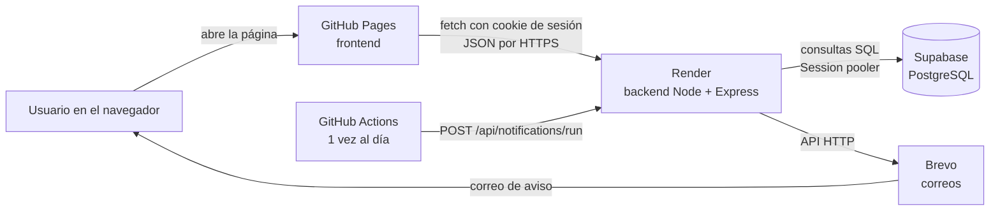

# Funcionamiento del backend de GarantyApp

Este documento explica cómo funciona el backend, qué servicio externo se usa en cada momento (Render, Supabase, GitHub, Brevo) y en qué archivo está cada cosa.

## 1. Visión general

GarantyApp está dividida en servicios, cada uno con una función:

| Servicio | Qué hace | Qué contiene |
|---|---|---|
| **GitHub Pages** | Publica el frontend | `index.html`, `pages/`, `css/`, `js/`, `assets/` |
| **Render** | Ejecuta el backend (Node.js + Express) | La carpeta `backend/` |
| **Supabase** | Guarda los datos (PostgreSQL) | Tablas de usuarios, garantías, categorías, documentos, sesiones y avisos |
| **Brevo** | Envía los correos de aviso | Se usa solo desde `backend/services/mailService.js` |
| **GitHub Actions** | Dispara los avisos una vez al día | `.github/workflows/notifications.yml` |



El frontend **nunca** habla con Supabase. Solo habla con el backend, y el backend es el único que habla con la base de datos.

## 2. ¿Dónde se usa cada servicio? (y en qué archivo)

### Render (donde corre el backend)

| Qué | Archivo |
|---|---|
| El servidor se arranca con `npm start`, que ejecuta `node server.js` | `backend/package.json` |
| Crea la app Express, activa CORS, sesiones y registra las rutas | `backend/server.js` |
| Render asigna el puerto automáticamente (variable `PORT`) | `backend/server.js` (`const PORT = process.env.PORT \|\| 3000`) |
| Render usa un proxy HTTPS, por eso se activa `trust proxy` para las cookies seguras | `backend/server.js` |
| Ruta de prueba para ver si el backend está despierto: `GET /` | `backend/server.js` |
| Las variables secretas se configuran en Render → Environment | (no están en ningún archivo) |

Configuración del servicio en Render: **Root Directory** `backend`, **Build Command** `npm install`, **Start Command** `npm start`.

### Supabase (la base de datos)

| Qué | Archivo |
|---|---|
| Conexión a PostgreSQL con `DATABASE_URL` (o `DB_HOST`, `DB_USER`, `DB_PASSWORD`, `DB_NAME`, `DB_PORT`) y SSL | `backend/database/connection.js` |
| Crea las tablas si no existen, cada vez que el servidor arranca | `backend/database/init.js` |
| Script para crear las tablas a mano en el SQL Editor de Supabase | `backend/database/supabase.sql` |
| Todas las consultas SQL (leer, crear, editar, borrar) | `backend/models/*.js` |
| Las sesiones de login se guardan en la tabla `user_sessions` | `backend/server.js` (`connect-pg-simple`) |

Solo `database/connection.js` abre la conexión. Los modelos importan ese mismo `pool`.

### GitHub Pages (el frontend)

| Qué | Archivo |
|---|---|
| URL del backend a la que llama el frontend (`API_URL`) | `js/config.js` |
| Función central que hace todas las llamadas al API | `js/api.js` (`GarantyAPI.request`) |
| Qué origen puede llamar al backend (CORS), variable `FRONTEND_URL` | `backend/server.js` |

### Brevo (correos) y GitHub Actions (aviso diario)

| Qué | Archivo |
|---|---|
| Programa la ejecución diaria y llama al backend | `.github/workflows/notifications.yml` |
| Endpoint que recibe esa llamada | `backend/routes/notifications.js` |
| Decide a quién avisar y registra lo enviado | `backend/controllers/notificationController.js` |
| Consulta qué garantías avisar | `backend/models/notificationModel.js` |
| Arma el correo y lo envía a Brevo | `backend/services/mailService.js` |

## 3. Variables de entorno

Se configuran en **Render → Environment**. Nunca se escriben en el código ni se suben a GitHub.

| Variable | Para qué sirve | La lee |
|---|---|---|
| `DATABASE_URL` | Conexión a Supabase (cadena *Session pooler*) | `database/connection.js` |
| `SESSION_SECRET` | Firma las cookies de sesión. Sin ella el servidor no arranca | `server.js` |
| `NODE_ENV` | `production` activa cookies `Secure` y `SameSite=None` | `server.js` |
| `FRONTEND_URL` | Dirección del frontend permitida por CORS (`https://usuario.github.io`) | `server.js` |
| `CRON_SECRET` | Clave que debe enviar GitHub Actions para disparar los avisos | `controllers/notificationController.js` |
| `BREVO_API_KEY` | Clave de la API de Brevo | `services/mailService.js` |
| `MAIL_FROM` | Correo remitente, verificado en Brevo | `services/mailService.js` |
| `MAIL_FROM_NAME` | (opcional) Nombre del remitente | `services/mailService.js` |
| `APP_URL` | Raíz de la página en GitHub Pages, terminada en `/`. **Obligatoria para recuperar contraseña**; en los avisos es el link del botón | `services/mailService.js` |

En **GitHub → Settings → Secrets → Actions** se guardan `API_URL` (URL del backend) y `CRON_SECRET` (el mismo valor que en Render).

## 4. Arquitectura MVC del backend

```
backend/
├── server.js          → arranca el servidor, CORS, sesiones y registro de rutas
├── routes/            → define los endpoints (URL + método) y a qué controlador van
├── controllers/       → recibe la petición, valida y responde en JSON
├── models/            → consultas SQL a la base de datos
├── database/          → conexión, creación de tablas y script SQL
├── middlewares/       → requireLogin.js (exige sesión iniciada)
└── services/          → mailService.js (comunicación con Brevo)
```

Una petición siempre sigue este camino: **`routes` → `controllers` → `models` → `database`**.

## 5. Ejemplo paso a paso: crear una garantía

Cuando el usuario pulsa "guardar" en el formulario de nueva garantía:

1. **`js/add-guarantee.js`** llama a `GarantyAPI.request("/api/guarantees", { method: "POST", body: ... })`.
2. **`js/api.js`** arma la URL completa (`API_URL` de `js/config.js` + `/api/guarantees`) y llama a `fetch` con `credentials: "include"`. Así el navegador envía la cookie de sesión aunque el backend esté en otro dominio.
3. La petición llega a **Render**, a `server.js`. Antes de llegar a las rutas pasa por:
   - `helmet` (cabeceras de seguridad),
   - el bloque de **CORS** (revisa que el origen esté en `FRONTEND_URL`),
   - `express.json` (convierte el cuerpo a un objeto; límite 3 MB),
   - `express-session` (lee la cookie y busca la sesión en la tabla `user_sessions` de **Supabase**).
4. **`routes/guarantees.js`** ve que es `POST /` y primero pasa por **`middlewares/requireLogin.js`**. Si no hay sesión, responde 401 y el frontend redirige a `login.html`.
5. **`controllers/guaranteeController.js`** (función `create`) valida los campos.
6. **`models/guaranteeModel.js`** (función `create`) ejecuta el `INSERT` en la tabla `guarantees`, con el `user_id` que viene de la sesión.
7. **`database/connection.js`** envía la consulta a **Supabase**.
8. La respuesta vuelve por el mismo camino: modelo → controlador (`res.status(201).json(...)`) → `api.js` → la pantalla.

Si algo falla (400, 404, 500), el controlador responde con un `message` y `api.js` lo lanza como `Error` para mostrarlo al usuario.

## 6. Sesión, login y cookies

- Al hacer login o registrarse, `controllers/authController.js` crea una sesión (`req.session.userId`). La sesión se guarda en la tabla **`user_sessions` de Supabase** y el navegador recibe una cookie.
- En cada llamada posterior, el navegador envía la cookie, `express-session` la busca en Supabase y `requireLogin` comprueba que exista `userId`.
- Como el frontend (`github.io`) y el backend (`onrender.com`) son sitios distintos, en producción la cookie usa `SameSite=None` y `Secure`, y el navegador debe aceptar cookies de terceros. **Safari y las ventanas de incógnito pueden bloquearla.**
- La contraseña nunca se guarda tal cual: se guarda el hash con `bcryptjs` (`authController.js`, columna `password_hash`).
- Cada consulta filtra por `user_id` de la sesión, así un usuario solo ve sus propios datos.

## 7. Mapa de endpoints

| Método y ruta | Archivo de rutas | Función del controlador | Modelo | Tabla(s) |
|---|---|---|---|---|
| `POST /api/auth/register` | `routes/auth.js` | `authController.register` | `userModel` | `users`, `user_sessions` |
| `POST /api/auth/login` | `routes/auth.js` | `authController.login` | `userModel` | `users`, `user_sessions` |
| `GET /api/auth/me` | `routes/auth.js` | `authController.me` | `userModel` | `users` |
| `PUT /api/auth/profile` | `routes/auth.js` | `authController.updateProfile` | `userModel` | `users` |
| `POST /api/auth/logout` | `routes/auth.js` | `authController.logout` | — | `user_sessions` |
| `POST /api/auth/forgot-password` | `routes/auth.js` | `passwordResetController.forgotPassword` | `userModel`, `passwordResetModel` | `users`, `password_resets` |
| `POST /api/auth/reset-password` | `routes/auth.js` | `passwordResetController.resetPassword` | `passwordResetModel` | `password_resets`, `users`, `user_sessions` |
| `GET /api/guarantees?status=` | `routes/guarantees.js` | `guaranteeController.list` | `guaranteeModel` | `guarantees` |
| `POST /api/guarantees` | `routes/guarantees.js` | `guaranteeController.create` | `guaranteeModel` | `guarantees` |
| `GET /api/guarantees/summary` | `routes/guarantees.js` | `guaranteeController.summary` | `guaranteeModel` | `guarantees` |
| `GET /api/guarantees/:id` | `routes/guarantees.js` | `guaranteeController.getOne` | `guaranteeModel` | `guarantees` |
| `PUT /api/guarantees/:id` | `routes/guarantees.js` | `guaranteeController.update` | `guaranteeModel` | `guarantees` |
| `DELETE /api/guarantees/:id` | `routes/guarantees.js` | `guaranteeController.remove` | `guaranteeModel` | `guarantees` |
| `GET /api/guarantees/:id/document` | `routes/guarantees.js` | `documentController.get` | `documentModel` | `guarantee_documents` |
| `PUT /api/guarantees/:id/document` | `routes/guarantees.js` | `documentController.save` | `documentModel` | `guarantee_documents` |
| `DELETE /api/guarantees/:id/document` | `routes/guarantees.js` | `documentController.remove` | `documentModel` | `guarantee_documents` |
| `GET /api/categories` | `routes/categories.js` | `categoryController.list` | `categoryModel` | `categories` |
| `POST /api/categories` | `routes/categories.js` | `categoryController.create` | `categoryModel` | `categories` |
| `DELETE /api/categories/:id` | `routes/categories.js` | `categoryController.remove` | `categoryModel` | `categories` |
| `POST /api/notifications/run` | `routes/notifications.js` | `notificationController.run` | `notificationModel` | `guarantees`, `users`, `notifications_sent` |

Todas las rutas de `guarantees` y `categories` exigen sesión iniciada. `notifications/run` no usa sesión: se protege con la cabecera `x-cron-secret`.

## 8. Base de datos (Supabase)

| Tabla | Contenido | Relación |
|---|---|---|
| `users` | Nombre, correo y hash de contraseña | — |
| `categories` | Categorías de cada usuario | `user_id` → `users` |
| `guarantees` | Producto, marca, precio, tienda, fechas, duración, categoría | `user_id` → `users` |
| `guarantee_documents` | Factura o comprobante (PDF/imagen en base64, máx. 1,5 MB) | `guarantee_id` → `guarantees` (uno por garantía) |
| `user_sessions` | Sesiones de login | — |
| `notifications_sent` | Avisos de vencimiento ya enviados | `guarantee_id` → `guarantees` |
| `password_resets` | Hash del token de recuperación de contraseña y su vencimiento | `user_id` → `users` |

Las claves foráneas usan `ON DELETE CASCADE`: si se borra un usuario o una garantía, se borran también sus datos asociados. Todas las tablas tienen RLS activado, sin políticas: la API pública de Supabase no puede leerlas, y solo el backend (rol `postgres`) accede.

## 9. Qué pasa cuando arranca el servidor en Render

1. Render ejecuta `npm install` y luego `npm start` (`node server.js`).
2. `server.js` comprueba que exista `SESSION_SECRET`; si no, se detiene con un error.
3. Ejecuta `initializeDatabase()` (`database/init.js`): crea las tablas que falten en Supabase y activa RLS.
4. Empieza a escuchar en el puerto que asignó Render.

En el plan gratis, Render duerme el servicio tras unos minutos sin uso. La primera llamada puede tardar hasta ~50 segundos mientras arranca.

## 10. Avisos de vencimiento por correo

1. **GitHub Actions** (`.github/workflows/notifications.yml`) corre todos los días a las 13:00 UTC (8:00 a. m. en Colombia) y hace `POST {API_URL}/api/notifications/run` con la cabecera `x-cron-secret`.
2. `controllers/notificationController.js` verifica la clave contra `CRON_SECRET`. Si no coincide, responde 401. Si `CRON_SECRET` no está configurada, responde 503.
3. `models/notificationModel.js` busca en **Supabase** las garantías que vencen en 30 días o menos y a las que aún no se les envió el aviso correspondiente (30, 7 o 1 día antes).
4. Por cada una, `services/mailService.js` arma el correo y lo envía con la **API HTTP de Brevo** (puerto 443).
5. Si Brevo lo acepta, se guarda un registro en `notifications_sent` para no repetir el aviso. Si falla, no se registra y se reintenta al día siguiente.

Se usa la API de Brevo y no SMTP porque Render bloquea los puertos SMTP (25, 465 y 587) en el plan gratuito.

Para probar sin enviar nada: `POST /api/notifications/run?dryRun=true` con la cabecera `x-cron-secret` lista lo que enviaría.

## 11. Recuperar contraseña

1. **`pages/recover-password.html`** + **`js/password-recovery.js`**: el usuario escribe su correo y se llama a `POST /api/auth/forgot-password`.
2. **`controllers/passwordResetController.js`** (`forgotPassword`): busca el usuario. Si existe, crea un token aleatorio de 64 caracteres, guarda en `password_resets` (Supabase) solo su **hash SHA-256** con vencimiento de 1 hora, y envía el correo con `services/mailService.js`. Siempre responde el mismo mensaje, exista o no el correo, para no revelar qué correos están registrados. Máximo 3 solicitudes cada 15 minutos por usuario.
3. El correo trae un enlace a **`pages/reset-password.html?token=...`**, armado con `APP_URL`.
4. En esa página el usuario escribe la contraseña nueva y se llama a `POST /api/auth/reset-password`.
5. **`models/passwordResetModel.js`** (`consumeAndReset`) hace todo en una transacción: borra el token (solo sirve una vez y solo si no venció), cambia el `password_hash` del usuario, borra sus demás tokens y cierra sus sesiones abiertas en `user_sessions`.

## 12. ¿Dónde cambio...?

| Quiero cambiar | Archivo |
|---|---|
| La URL del backend que usa el frontend | `js/config.js` |
| El texto o diseño del correo | `backend/services/mailService.js` |
| Cuántos días antes se avisa (30, 7, 1) | `backend/models/notificationModel.js` |
| A qué hora se envían los avisos | `.github/workflows/notifications.yml` (línea `cron`) |
| La base de datos a la que se conecta | Variable `DATABASE_URL` en Render |
| Qué página puede llamar al backend | Variable `FRONTEND_URL` en Render |
| Las tablas de la base de datos | `backend/database/supabase.sql` y `backend/database/init.js` |
| Validaciones de un formulario (servidor) | `backend/controllers/*.js` |
| Una consulta SQL | `backend/models/*.js` |
| Agregar un endpoint nuevo | `routes/` + `controllers/` + `models/`, y registrarlo en `server.js` |

## 13. Errores frecuentes y su causa

| Síntoma | Causa probable |
|---|---|
| `Failed to fetch` al crear cuenta | Backend dormido o caído, `API_URL` incorrecta en `js/config.js`, o `FRONTEND_URL` mal escrita en Render (error de CORS) |
| La página sale sin estilos | Archivos viejos con rutas que empiezan con `/css/...` en vez de `../css/...` |
| Se pierde la sesión al recargar | El navegador bloquea cookies de terceros (Safari o incógnito), o falta `NODE_ENV=production` en Render |
| El backend no arranca (`SESSION_SECRET`) | Falta esa variable en Render |
| `password authentication failed` en los logs | `DATABASE_URL` mal copiada, o contraseña con símbolos sin codificar |
| El correo no llega | Falta `BREVO_API_KEY` o `MAIL_FROM`, remitente no verificado, bloqueo de IPs activo en Brevo, o el correo cayó en spam |
| No llega el correo de recuperar contraseña | Falta `APP_URL`, `BREVO_API_KEY` o `MAIL_FROM` en Render (en los Logs aparece "Recuperación de contraseña: faltan..."), o el correo cayó en spam |
| El workflow falla con `No host part in the URL` | Falta el secret `API_URL` en GitHub |
| El workflow falla con 401 | `CRON_SECRET` distinto entre GitHub y Render |
