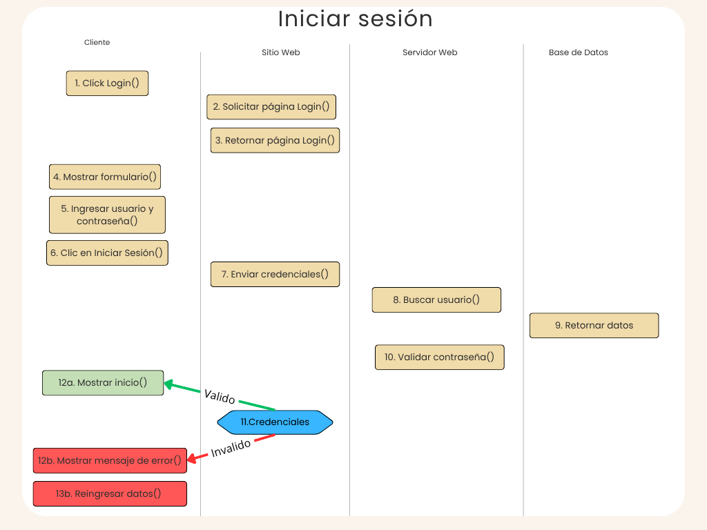
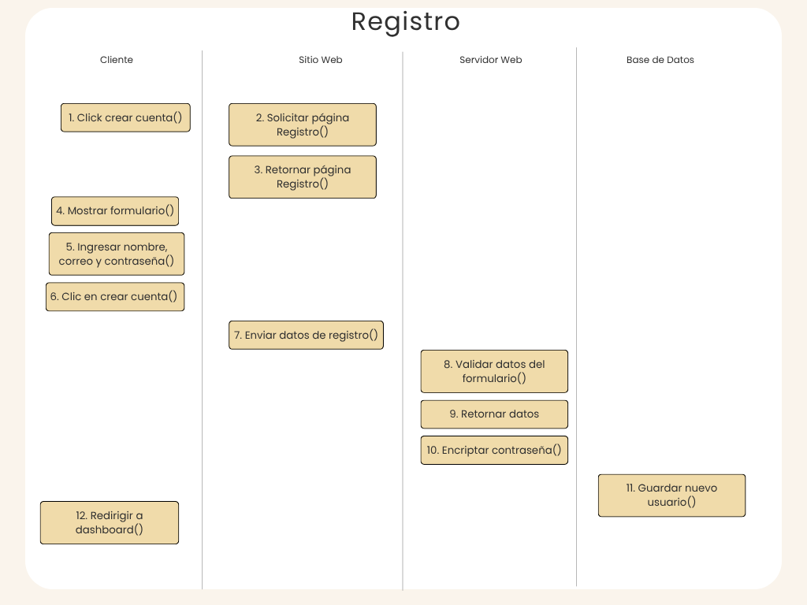
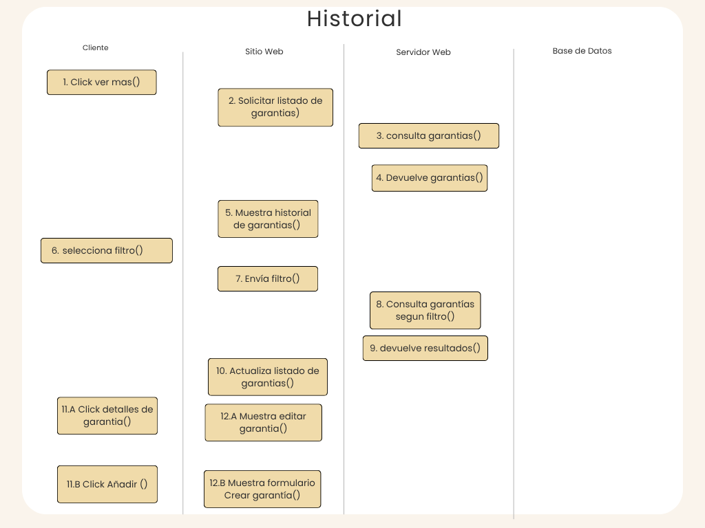
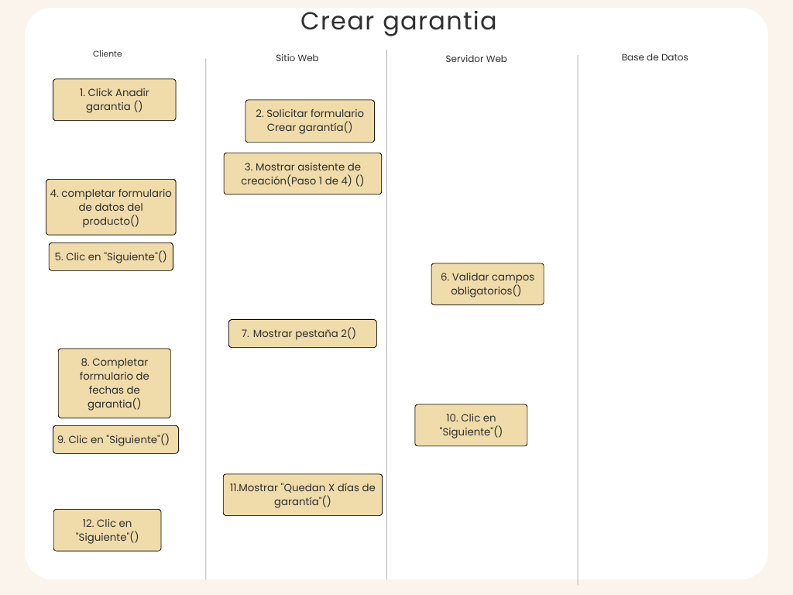
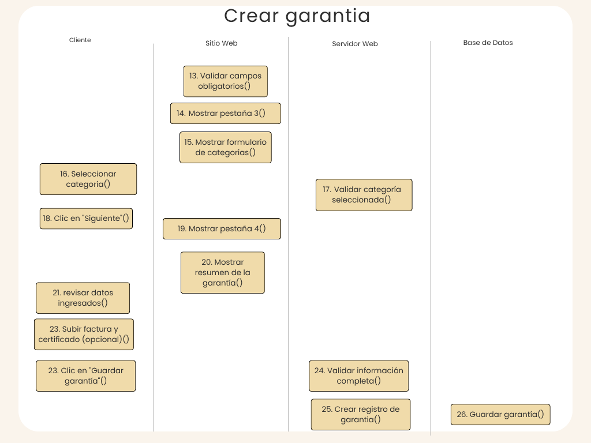
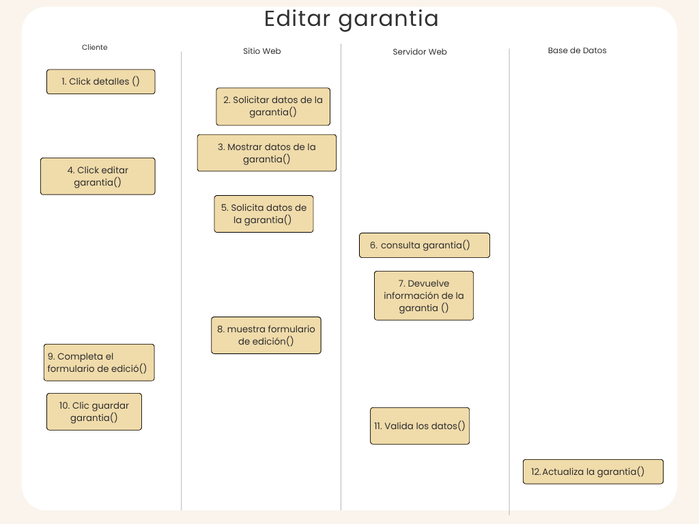

# 🌐 GarantyApp

GarantyApp es una aplicación móvil / web en español diseñada para centralizar el registro, seguimiento y notificación de garantías de productos personales, eliminando la dependencia de papeles físicos y evitando que el usuario pierda sus derechos por olvido.

# 👥 Integrantes

Verónica Cerquera – 1202756
Samanta Manosalva – 1202769
Isabel Obando - 1202730


## 🎯 1. Objetivo General

Desarrollar una aplicación móvil / Web que permita a los usuarios registrar, organizar y hacer seguimiento de las garantías de sus productos, mediante un registro digital centralizado y recordatorios automáticos sobre sus fechas de vencimiento. Con esta aplicación se busca solucionar el problema de la pérdida de garantías por olvido o falta de información sobre sus fechas de vigencia, evitando así posibles pérdidas económicas y facilitando el acceso a información sobre los derechos del consumidor en Colombia relacionados con las garantías.


## 🌍 2. Contexto de Uso

El sistema será utilizado por consumidores hispanohablantes entre 18 y 60 años que realizan compras de productos con garantía, como electrodomésticos, celulares, computadores, muebles y herramientas. Los usuarios podrán registrar digitalmente sus productos y la información relacionada con sus garantías, organizar y consultar fácilmente sus datos, y recibir recordatorios antes de las fechas de vencimiento, con el fin de mantener un seguimiento adecuado y evitar la pérdida de sus derechos de garantía por olvido, extravío de comprobantes o desconocimiento de las fechas de vigencia.


## 📋 3. Requerimientos del Sistema

## 3.1 Requerimientos Funcionales

Los requerimientos funcionales describen las acciones y funcionalidades que ofrece GarantyApp al usuario.

- **RF01:** El sistema debe permitir al usuario crear una cuenta mediante nombre, correo electrónico y contraseña.
- **RF02:** El sistema debe permitir al usuario iniciar sesión con sus credenciales.
- **RF03:** El sistema debe permitir registrar productos con garantía, ingresando su nombre, fecha de compra, duración de la garantía, categoría y lugar de compra.
- **RF04:** El sistema debe permitir guardar comprobantes para asociarlos a los productos registrados.
- **RF05:** El sistema debe calcular automáticamente la fecha de vencimiento de la garantía a partir de la fecha de compra y su duración.
- **RF06:** El sistema debe permitir visualizar el historial de productos y garantías registradas.
- **RF07:** El sistema debe permitir buscar productos registrados por su nombre.
- **RF08:** El sistema debe permitir filtrar las garantías por categoría y estado, como garantías activas o próximas a vencer.
- **RF09:** El sistema debe mostrar los días restantes antes del vencimiento de cada garantía.
- **RF10:** El sistema debe generar notificaciones locales para informar al usuario sobre las garantías próximas a vencer.
- **RF11:** El sistema debe proporcionar una sección con información sobre los derechos del consumidor en Colombia relacionados con las garantías.

### 3.2 Requerimientos No Funcionales

Los requerimientos no funcionales describen las características y condiciones de funcionamiento de GarantyApp.

- **RNF01:** La aplicación debe contar con una interfaz completamente en español.
- **RNF02:** La aplicación debe tener una interfaz sencilla, intuitiva y fácil de utilizar.
- **RNF03:** El sistema debe funcionar como una aplicación móvil.
- **RNF04:** La aplicación debe ser compatible con dispositivos Android 8.0 o superior, según los requisitos mínimos establecidos.
- **RNF05:** La aplicación debe permitir el almacenamiento local de los datos y las imágenes de las garantías en el dispositivo.
- **RNF06:** La aplicación debe poder funcionar sin conexión a internet una vez instalada.
- **RNF07:** La aplicación debe solicitar los permisos necesarios para acceder a la cámara, galería y notificaciones del dispositivo.
- **RNF08:** La información registrada debe presentarse de manera organizada para facilitar su consulta y seguimiento.


## 🧠 4. Diagramas UML

### 4.1 Diagrama de Casos de Uso


El diagrama representa los casos de uso del sistema GarantyApp, mostrando las principales funcionalidades que ofrece la aplicación y la interacción entre sus actores y el sistema. El usuario de sitio puede crear una cuenta, iniciar sesión, recuperar su contraseña, registrar productos con garantía, consultar el historial de garantías, filtrar por categoría y consultar los derechos del consumidor. Además, el sistema se encarga de recibir y gestionar las notificaciones sobre las fechas de vencimiento de las garantías. En general, el diagrama permite identificar cómo los usuarios interactúan con GarantyApp y cómo se organizan sus funcionalidades en tres áreas principales: autenticación, garantías e información.

### 4.2 Diagrama de Secuencia

Inicio de Sesion.


Registro.


Historial


Crear garantia



Editar garantia


## 🎨 5. URL del Prototipo

Enlace público de Figma:

https://www.figma.com/design/WlO61BO3snQnISWMoZemX7/GarantyApp-Atomic-desing?node-id=39-881&t=hinoLJ3cLaNjImts-1


## 🗄️ 6. Diseño de Base de Datos

Agregar imagen del modelo.
Tablas principales

## 🧩 7. Documentación del Sistema de estructura de Carpetas

- **`css/`**: Carpeta que contiene los archivos CSS encargados de definir los estilos y la apariencia visual de las distintas páginas del proyecto.
- **`css/styles_tokens.css`**: Define los tokens comunes de color. Cada hoja CSS de página aplica directamente Poppins, texto base de 14 px, encabezados de 64 px y la misma paleta; las opacidades de estados y superficies se conservan.
- **`pages/`**: Carpeta que contiene los archivos HTML correspondientes a las diferentes páginas del sitio web.
- **`pages/add-guarantee.html`**: Asistente para registrar un producto y los datos de su garantía, con estilos en `css/styles_add_guarantee.css` y navegación de pasos en `js/add-guarantee.js`.
- **`pages/guarantee-category.html`**: Selección, creación y eliminación de categorías dentro del registro de garantías; las categorías se conservan en el navegador y el avance del formulario se conserva temporalmente.
- **`css/styles_guarantee_category.css`** y **`js/guarantee-category.js`**: Estilos e interacciones de la pantalla de categorías.
- **`pages/guarantee-created.html`**: Confirmación al finalizar el registro de una garantía, con estilos en `css/styles_guarantee_created.css` y detalles en `js/guarantee-created.js`.
- **`pages/guarantee-details.html`**, **`pages/guarantee-edit.html`** y **`pages/guarantee-documents.html`**: consulta, edición y gestión de documentos de una garantía; los cambios y archivos adjuntos se guardan localmente en el navegador.
- **`js/guarantee-records.js`** y **`js/guarantee-links.js`**: datos de ejemplo del historial y conexión de los botones «Detalles» al registro correspondiente.
- **`css/styles_guarantee_record.css`**: estilos compartidos de las páginas de detalles, edición y documentos; cada vista tiene además su hoja CSS específica.
- **`js/`**: Scripts de interacción de las páginas que necesitan comportamiento dinámico.
- El dashboard (`pages/dashboard.html`) es la entrada al historial de garantías. Sus tarjetas y los filtros antiguos abren el dashboard con `?status=active`, `?status=expiring` o `?status=expired`; sin parámetro, muestra todas las garantías.


**Backend (`backend/`) — arquitectura MVC**

- **`backend/server.js`**: arranca Express, configura CORS, sesiones y registra las rutas.
- **`backend/routes/`**: define los endpoints (`auth.js`, `guarantees.js`, `categories.js`). Solo asocia cada ruta con su controlador.
- **`backend/controllers/`**: recibe la solicitud, valida los datos, llama al modelo y responde en JSON (`authController.js`, `guaranteeController.js`, `documentController.js`, `categoryController.js`).
- **`backend/models/`**: acceso a los datos; aquí están las consultas SQL (`userModel.js`, `guaranteeModel.js`, `documentModel.js`, `categoryModel.js`).
- **`backend/database/`**: conexión a Supabase PostgreSQL (`connection.js`), creación de tablas al iniciar (`init.js`) y el script `supabase.sql`.
- **`backend/middlewares/`**: `requireLogin.js`, comprueba que haya sesión iniciada antes de las rutas privadas.

Flujo de una petición: `routes → controllers → models → database`.


## 🚀 8. Instalación y Ejecución

**Arquitectura:** el frontend (HTML/CSS/JS) se publica en **GitHub Pages** y el backend (Node + Express + PostgreSQL) en **Render**. El front llama al backend por HTTPS.

| Parte | Dónde | URL |
|---|---|---|
| Frontend | GitHub Pages | `https://TU-USUARIO.github.io/NOMBRE-DEL-REPO/` |
| Backend (API) | Render | https://garantyapp-backend.onrender.com |

### 8.1 Cómo se hacen las llamadas al API

1. `js/config.js` guarda la URL del backend (`API_URL`). Es el único lugar donde se cambia.
2. `js/api.js` define `GarantyAPI.request(ruta, { method, body })`, la función que usan **todas** las pantallas. Arma la URL (`API_URL + ruta`), llama a `fetch` con `credentials: "include"` (para enviar la cookie de sesión), manda el `body` como JSON y lanza un `Error` con el mensaje del backend si la respuesta no es exitosa. Si el backend responde 401, redirige a `login.html`.
3. Cada archivo de `js/` tiene comentarios `API:` sobre cada llamada, indicando método, ruta y qué hace.

```js
// Ejemplo: crear una categoría
const { category } = await GarantyAPI.request("/api/categories", {
  method: "POST",
  body: { name: "Hogar" }
});
```

| Método y ruta | Descripción |
|---|---|
| `POST /api/auth/register` | Crear cuenta e iniciar sesión |
| `POST /api/auth/login` | Iniciar sesión |
| `GET /api/auth/me` | Usuario de la sesión actual (401 si no hay) |
| `PUT /api/auth/profile` | Actualizar nombre y correo |
| `POST /api/auth/logout` | Cerrar sesión |
| `GET /api/guarantees?status=` | Listar garantías (`active`, `expiring`, `expired`) |
| `POST /api/guarantees` | Crear garantía |
| `GET /api/guarantees/summary` | Contadores del dashboard |
| `GET / PUT / DELETE /api/guarantees/:id` | Ver, editar o eliminar una garantía |
| `GET / PUT / DELETE /api/guarantees/:id/document` | Factura o comprobante (PDF/imagen) |
| `GET / POST /api/categories` | Listar o crear categorías |
| `DELETE /api/categories/:id` | Eliminar categoría |

### 8.2 Backend en Render

1. Crear la base de datos en **Supabase** (ver 8.2.1) y copiar su `DATABASE_URL`.
2. Crear un **Web Service** conectado a este repositorio con:
   - **Root Directory:** `backend`
   - **Build Command:** `npm install`
   - **Start Command:** `npm start`
3. En **Environment** agregar las variables (ver `backend/.env.example`):
   - `DATABASE_URL` = cadena **Session pooler** de Supabase
   - `SESSION_SECRET` = un texto largo y secreto
   - `NODE_ENV` = `production`
   - `FRONTEND_URL` = `https://TU-USUARIO.github.io` (solo el dominio, sin ruta ni `/` final)
4. Probar abriendo la URL del servicio: debe responder `{"message":"GarantyApp API funcionando."}`. Las tablas se crean solas al iniciar.

> En el plan gratuito de Render el servicio se duerme tras unos minutos sin uso; la primera llamada puede tardar ~50 segundos.

### 8.2.1 Base de datos en Supabase

1. En [supabase.com](https://supabase.com) crear un proyecto nuevo (guardar la contraseña de la base de datos).
2. **SQL Editor → New query**, pegar el contenido de `backend/database/supabase.sql` y pulsar **Run**. Crea las tablas `users`, `categories`, `guarantees`, `guarantee_documents` y `user_sessions`, y activa RLS.
3. Pulsar **Connect** (arriba) → **Session pooler** → copiar la cadena y reemplazar `[YOUR-PASSWORD]` por la contraseña. Esa cadena es la `DATABASE_URL` de Render.
4. Usar el *Session pooler* y no *Direct connection*: la conexión directa usa IPv6 y Render no la alcanza.

### 8.3 Frontend en GitHub Pages

1. Subir el proyecto al repositorio (rama `main`).
2. En GitHub: **Settings → Pages → Build and deployment → Deploy from a branch → `main` / `(root)` → Save**.
3. Abrir `https://TU-USUARIO.github.io/NOMBRE-DEL-REPO/` (el `index.html` de la raíz redirige a `pages/index.html`).
4. Si la URL del backend cambia, editar `API_URL` en `js/config.js`.

### 8.4 Ejecutar en local

```bash
cd backend
cp .env.example .env      # completar DATABASE_URL y SESSION_SECRET
npm install
npm start                 # API en http://localhost:3000
```

Abrir `pages/index.html` con **Live Server** de VS Code (puerto 5500). `config.js` detecta `localhost` y usa el backend local automáticamente.

### 8.5 Avisos de vencimiento por correo

Cada día un workflow de **GitHub Actions** (`.github/workflows/notifications.yml`) llama a `POST /api/notifications/run` en el backend. El backend busca las garantías que vencen en 30 días o menos y envía un correo con la **API HTTP de Brevo** a los 30, 7 y 1 día antes del vencimiento. La tabla `notifications_sent` guarda lo ya enviado para no repetir correos.

> Se usa la API de Brevo (HTTPS) y no SMTP porque Render bloquea los puertos SMTP en el plan gratuito.

**Variables en Render:** `BREVO_API_KEY`, `MAIL_FROM` (correo verificado en Brevo), `CRON_SECRET` (texto secreto inventado por ti) y, opcional, `MAIL_FROM_NAME` y `APP_URL`.

**Secrets en GitHub** (Settings → Secrets and variables → Actions): `CRON_SECRET` (el mismo de Render) y `API_URL` (URL del backend, sin `/` al final).

**Probar:** `POST /api/notifications/run?dryRun=true` con la cabecera `x-cron-secret` lista lo pendiente sin enviar nada. El workflow también se puede ejecutar a mano desde la pestaña *Actions → Run workflow*.
